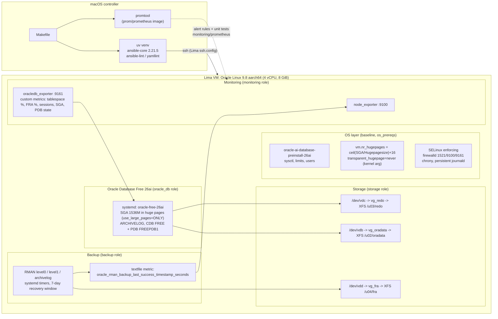

# oracle-ops-lab

A lab that provisions a Linux VM into a tuned Oracle Database host, end to end, with
Ansible: kernel and memory tuning (huge pages, THP off), LVM/XFS volumes per role,
Oracle Database Free under systemd, RMAN backups on timers, a destructive restore drill
with measured RTO, Prometheus exporters with alert rules and unit tests, and a patching
workflow with pre/post checks. Everything in `docs/EVIDENCE.md` was captured from real runs.

The VM is a Lima guest on Apple Silicon standing in for a VMware-hosted VM. The point is
the infrastructure layer under Oracle, not Oracle administration itself.

## Architecture



## What it demonstrates

| Area | In this repo |
|---|---|
| Provision Oracle on Linux VMs | `ansible/site.yml`: six roles converge a blank OL9 image into a running, tuned database host; second run is idempotent |
| Tune the Linux layer under Oracle | preinstall RPM with explicit sysctl/limits assertions; huge pages sized from the SGA and the live `Hugepagesize`; THP off via kernel argument; `use_large_pages=ONLY` so the instance proves it uses them |
| Storage layout | one disk per role (data / redo / FRA) -> LVM -> XFS, guarded against touching the wrong disk; multipath.conf template for SAN hosts (off in the lab) |
| Backup and recovery | RMAN incremental strategy on systemd timers; `RESTORE DATABASE VALIDATE`; a destructive lost-datafile drill that measures RTO and writes a report |
| Observability of the Oracle tier | node_exporter + Oracle's metrics exporter, custom SQL metrics, Prometheus rules (`DatabaseDown`, `BackupTooOld`, `FRAAlmostFull`, `TablespaceAlmostFull`, `HugePagesNotInUse`, ...) with promtool unit tests in CI |
| Patching | pre-checks (space, DB health, backup freshness), `dnf`, reboot only when `needs-restarting` says so, orderly DB stop/start, post-checks; `serial` for fleets |
| Runbooks | `docs/runbooks/`: six runbooks covering the alerts (all but `NotInArchivelogMode`) and the patching operation |

## Quickstart

Requirements: macOS on Apple Silicon, Homebrew, Docker (for promtool only), `uv`.
About 2.5 GB of downloads (OL9 image, Oracle RPM, exporters) and ~20 GB of disk on the
host after deploy, backups and a patch run (sparse disk images grow with use).

```bash
make bootstrap     # brew install lima; uv sync; ansible collections; generate secrets (gitignored)
make vm            # create 3 extra disks and start the Lima VM (Oracle Linux 9, aarch64)
make deploy        # converge everything (first run ~25 min, mostly DBCA)
make deploy        # again: idempotent
make test          # promtool check + unit tests, then live assertions against the VM
make backup        # RMAN level 0 now (LEVEL=level1|archivelog)
make drill         # restore validate + destructive datafile drill -> docs/drills/*.md
make patch         # OS patching with guard rails (SECURITY=1 for security-only)
make lint          # yamllint + ansible-lint (production profile)
make stop          # stop the VM, keep everything
```

`make ssh` opens a shell in the VM. The SYS/SYSTEM password is in `ansible/secrets/secrets.yml`
(generated, gitignored). Useful once inside:

```bash
sudo runuser -u oracle -- /usr/local/bin/oraops-sql "select name, open_mode from v\$pdbs"
sudo systemctl status oracle-free-26ai node_exporter oracledb_exporter
curl -s localhost:9161/metrics | grep oracledb_ops_
```

## Repo map

```
Makefile                      entry points (bootstrap, vm, deploy, backup, drill, patch, test, lint, stop, destroy)
pyproject.toml / uv.lock      pinned controller tooling (ansible-core, ansible-lint, yamllint)
lima/oracle-ops-lab.yaml      VM definition: OL9 aarch64, 4 vCPU, 8 GiB, 3 extra unformatted disks
ansible/
  site.yml                    role order: baseline -> os_prereqs -> storage -> oracle_db -> backup -> monitoring
  inventory/hosts.yml         one host, SSH via Lima's generated ssh.config
  inventory/group_vars/all.yml  every tunable and every pinned artifact + checksum
  requirements.yml            pinned collections (community.general, ansible.posix)
  roles/baseline              packages, chrony, firewalld, SELinux, journald
  roles/os_prereqs            preinstall RPM, sysctl/limits assertions, huge pages, THP, reboot-if-needed
  roles/storage               guarded LVM + XFS per disk, multipath template
  roles/oracle_db             RPM install, vendor configure, spfile parameters, ARCHIVELOG, redo relocation
  roles/backup                RMAN scripts, wrapper with textfile metrics, systemd service + timers
  roles/monitoring            node_exporter, Oracle exporter, monitoring DB account, custom metrics
  playbooks/backup.yml        run a backup level now through the systemd unit
  playbooks/restore-drill.yml validate + destructive drill with RTO report
  playbooks/patch.yml         patching with pre/post checks
  playbooks/verify.yml        read-only assertions used by `make test`
monitoring/prometheus/        alerts.yml, tests/alerts_test.yml, example prometheus.yml
docs/DEEP_DIVE.md             top-to-bottom technical walkthrough
docs/EVIDENCE.md              trimmed real output from the runs (dates, versions)
docs/runbooks/                instance won't start (huge pages), FRA full, backup failed/too old,
                              restore lost datafile, patching, tablespace almost full
docs/drills/                  generated restore-drill reports
scripts/                      gen-secrets.sh, collect-evidence.sh
.github/workflows/ci.yml      lint + promtool unit tests (no VM in CI)
```

## Lab versus production: honest scope

- **Lima is not VMware.** It gives a real Linux kernel on real virtual disks, which is what
  the OS and storage roles need, but there is no vSphere layer: no PVSCSI controllers, no
  VMDK provisioning choices, no memory reservations, no vNUMA, no CPU-ready contention.
  `docs/DEEP_DIVE.md` section 6 covers what changes there.
- **Multipath is template-only.** A VM has one path to each virtual disk; `multipath.conf`
  is rendered only when `multipath_enabled: true` with real WWIDs.
- **Oracle Database Free** limits CPU to 2 threads, memory to 2 GB and user data to 12 GB,
  and has no RAC or Data Guard. RMAN here runs without a recovery catalog (control file
  only), a lab choice. The SGA is 1.5 GiB so that the huge page work is real but small.
- **Single node.** No standby, no replication; the restore drill is a single-datafile
  recovery, not a site failover.
- **Secrets** are a generated, gitignored file, not a vault or secret store.
- **The patch run** updates an OL9 cloud image, not a hardened production baseline.

Oracle Database Free is distributed under the Oracle Free Use Terms and Conditions; nothing
from Oracle is redistributed here, the role downloads the RPM from Oracle and verifies its
published SHA-256.
