# oracle-ops-lab: deep dive

This document walks through the lab from the top down. It is written for an engineer who
is comfortable with servers, containers and CI but has not administered Linux at the kernel
level, never run Oracle, and has not written Ansible. By the end you should be able to
explain every file in the repository and every number in `docs/EVIDENCE.md` in your own
words. It is long because it explains *why*; it is not padded.

Sections:

1. The system in one paragraph, and the architecture
2. Every tool and package, and why it is here
3. The run order, role by role, with the concept behind each important task
4. Code walkthroughs of the key files
5. Run it yourself, and break/fix exercises
6. What changes in production (VMware, SAN, Data Guard, RMAN catalog, snapshots, licensing)
7. Glossary

---

## 1. The system in one paragraph

A Mac runs Ansible from a `uv`-managed virtualenv against a Lima virtual machine
(Oracle Linux 9 on Apple's hypervisor) that has one root disk and three extra blank disks.
`site.yml` turns that VM into a database host in six roles: `baseline` (packages, time,
firewall, SELinux, logs), `os_prereqs` (Oracle's preinstall RPM, kernel parameter and
limit assertions, a huge page pool sized from the SGA, Transparent Huge Pages off, one
reboot), `storage` (each blank disk -> LVM -> XFS mounted as data, redo and FRA volumes),
`oracle_db` (Oracle Database Free installed from the vendor RPM, the database created by
the vendor script onto the data volume, then the instance reconfigured: SGA locked into huge
pages with `use_large_pages=ONLY`, ARCHIVELOG mode, redo moved to the redo volume, FRA on the
FRA volume), `backup` (RMAN level 0 / level 1 / archived-log scripts on systemd timers with a
wrapper that publishes backup freshness as a Prometheus metric) and `monitoring`
(node_exporter and Oracle's database exporter with custom SQL metrics). Around it sit a
restore drill that destroys a datafile and measures the time to recover it, a patching
playbook with pre/post checks, Prometheus alert rules with unit tests, and runbooks.

### Architecture

```mermaid
flowchart TB
  subgraph controller["macOS (controller)"]
    make["make deploy / backup / drill / patch / test"]
    ansible["ansible-playbook<br/>(.venv via uv)"]
    promtool["promtool<br/>(docker: prom/prometheus)"]
    make --> ansible
    make --> promtool
  end

  subgraph lima["Lima VM (vz) — Oracle Linux 9.8 aarch64, 4 vCPU, 8 GiB, kernel 6.12 UEK"]
    subgraph kernel["kernel + OS"]
      sysctl["sysctl: shm*, sem, file-max, aio-max-nr,<br/>port range, net.core.*mem, hugetlb_shm_group"]
      hpool["huge page pool<br/>vm.nr_hugepages=784 (2 MiB each)"]
      thp["transparent_hugepage=never<br/>(kernel cmdline, grubby)"]
      limits["limits.d: memlock, nofile, nproc, stack"]
      selinux["SELinux enforcing · firewalld · chrony · journald"]
    end
    subgraph disks["virtio disks"]
      vda["vda 40G root"]
      vdb["vdb 20G → vg_oradata/lv_oradata → XFS /u02/oradata"]
      vdc["vdc 4G → vg_redo/lv_redo → XFS /u03/redo"]
      vdd["vdd 20G → vg_fra/lv_fra → XFS /u04/fra"]
    end
    subgraph oracle["Oracle Database Free 26ai (23.26.3)"]
      svc["systemd oracle-free-26ai<br/>(sysv generator + drop-in RequiresMountsFor)"]
      sga["SGA 1536 MiB in huge pages<br/>use_large_pages=ONLY · PGA 384 MiB"]
      cdb["CDB FREE (ARCHIVELOG) · PDB FREEPDB1"]
      lsnr["listener :1521"]
    end
    subgraph backup["backup"]
      timers["timers: level0 Sun 01:00 · level1 Mon–Sat 01:00 · archivelog hourly"]
      wrapper["/usr/local/bin/oracle-rman-backup<br/>→ RMAN → log → state → .prom"]
    end
    subgraph monitoring["monitoring"]
      ne["node_exporter :9100<br/>+ textfile collector"]
      oe["oracledb_exporter :9161<br/>user C##OPSMON, custom TOML metrics"]
    end
    sga --> hpool
    cdb --> vdb
    cdb --> vdc
    wrapper --> vdd
    wrapper --> ne
    oe --> lsnr
    timers --> wrapper
  end

  ansible -- "SSH (Lima ssh.config)" --> lima
  promtool -. "monitoring/prometheus/alerts.yml + tests" .-> monitoring
```



---

## 2. Every tool and package: what, why, how, alternatives

### Lima (`limactl` 2.2.1, via Homebrew)

**What.** Lima ("Linux machines") creates and manages Linux VMs on macOS. On Apple Silicon
it uses Apple's Virtualization.framework (`vmType: vz`), so the guest runs a real aarch64
Linux kernel with virtio disks and NICs. It downloads a cloud image, injects a user and SSH
key through cloud-init, forwards ports, and writes an SSH config file per VM.

**Why here.** The job is "Oracle on Linux VMs on VMware". A VM, not a container, is the
honest stand-in: Oracle needs kernel parameters, huge pages, SELinux, block devices,
systemd and a reboot cycle, none of which a container owns. Lima gives all of that for free
and lets Ansible treat the VM exactly like a remote server (SSH, `become`).

**How it is used.** `lima/oracle-ops-lab.yaml` bases on Lima's `oraclelinux-9` image
template (OL9 U8 aarch64 KVM cloud image from yum.oracle.com, SHA-256 pinned by Lima),
sets 4 vCPU / 8 GiB / 40 GiB root, and attaches three disks created by
`limactl disk create` with `format: false` so they arrive blank. `limactl start` boots it;
`~/.lima/oracle-ops-lab/ssh.config` is what Ansible's inventory points at.

**Alternatives.** UTM/QEMU (slower without vz, more clicking), Vagrant (no first-class
Apple Silicon providers), VMware Fusion (closest to production but licensed and GUI-driven),
Docker container (cannot do kernel params/huge pages/systemd honestly). Lima is scriptable,
free, fast on Apple Silicon, and a CNCF project.

### Oracle Linux 9 (9.8, UEK R8 kernel 6.12)

**What.** Oracle's RHEL-compatible distribution with Oracle's own "Unbreakable Enterprise
Kernel". `dnf` package manager, systemd, SELinux, firewalld.

**Why.** Oracle Database Free 26ai on aarch64 is supported on OL8 and OL9 only, and the
preinstall RPM lives in Oracle's yum repos. OL9 was picked over OL8 because the Oracle
docs set the aarch64 floor at OL9.4/UEK7 for 26ai, OL9 has a longer life, and the lab
image for OL9 ships with Python 3.9 (fine for Ansible).

**Page size caveat.** Apple Silicon only supports 4 KiB and 16 KiB page granules; a 64 KiB
page aarch64 kernel will not boot under vz. The OL9 UEK kernel uses 4 KiB pages
(`getconf PAGESIZE` = 4096) and its huge page size is 2 MiB (`Hugepagesize: 2048 kB`).
Both are read at run time, never assumed.

### uv 0.10 and the pinned Python tooling

**What.** `uv` is a fast Python package/project manager. `pyproject.toml` declares
`ansible-core==2.21.5`, `ansible-lint==26.10.1`, `yamllint==1.38.0`; `uv sync` creates
`.venv` and `uv.lock` records every transitive version.

**Why.** Ansible is a Python program and its behaviour depends on its exact version;
installing it with `brew` or `pip --user` makes the result depend on the machine. A
lockfile in the repo makes "the controller" reproducible on any Mac or in CI. Everything
is user-space: nothing touches the system Python.

**Alternatives.** `pipx` (one tool per env, no lockfile for a project), Poetry (slower,
heavier), a container for the controller (fine, but SSH-agent and Lima socket plumbing get
awkward).

### ansible-core 2.21.5 and the two collections

**What.** Ansible pushes small Python modules over SSH to a target, runs them, and reads
back JSON. It is agentless: the VM only needs `sshd` and Python 3. `ansible-core` is the
engine plus `ansible.builtin`; everything else comes from *collections*. Two are pinned in
`ansible/requirements.yml`:

- `community.general` 13.5.0 for `lvg`, `lvol`, `filesystem` (LVM and mkfs);
- `ansible.posix` 2.2.2 for `mount`, `sysctl`, `firewalld`, `selinux`.

**Why.** Ansible is the JD's tool and the industry default for Linux fleets: declarative
("this mount exists with these options"), idempotent (a second run changes nothing),
readable by non-programmers, and it runs over SSH without installing agents on 5,000
servers. Collections are installed with `ansible-galaxy` into `ansible/collections`
(gitignored) so the versions are explicit.

**How it is used.** `ansible/ansible.cfg` points at the inventory, roles and collections
and turns on SSH pipelining (one SSH round trip per task instead of three).
`site.yml` is a *playbook*: a list of *plays* (here one) that apply *roles* to *hosts*.
A role is a directory with `tasks/`, `templates/`, `files/`, `handlers/`, `defaults/`.
Each task calls one module with arguments. `become: true` means `sudo`. `register` keeps a
task's result in a variable; `when` makes a task conditional; `assert` fails the run if a
condition is false; `notify`/handlers run once at the end of a play if something changed.

**Alternatives.** Puppet/Chef (agent-based, Ruby DSL, strong for drift enforcement, heavier
to run), Salt (agent or SSH, fast at scale, smaller community), Terraform (provisions
infrastructure, not OS configuration), shell scripts (not idempotent, no inventory model).

### ansible-lint 26.10.1 (production profile) and yamllint 1.38.0

**What.** `ansible-lint` checks playbooks and roles against rules ranging from "tasks must be
named" to "commands must declare when they change something" and "variables inside a role
must be prefixed with the role name". The `production` profile is the strictest built-in
set. `yamllint` checks the YAML itself (indentation, line length, document start, truthy
values).

**Why.** Lint is the only test that runs without a VM, so it is what CI can enforce.
The production profile forced several real improvements here: every `command` task says
when it changes state, every `become_user` has `become`, every variable registered inside
a role carries its role prefix so playbooks cannot collide, file modes are always explicit.

### The Oracle preinstall RPM (`oracle-ai-database-preinstall-26ai` 1.0-3.el9)

**What.** A 35 KB RPM from Oracle's OL9 AppStream repo whose only job is to prepare the OS.
Its dependency list pulls in every library Oracle needs (`libaio`, `ksh`, `glibc-devel`,
`libgfortran`, `sysstat`, `smartmontools`, `bind-utils`, `compat-openssl11`,
`libxcrypt-compat`, ...). Its `%posttrans` scriptlet runs
`/usr/bin/oracle-ai-database-preinstall-26ai-verify`, a 1,500-line bash script driven by a
parameter file (`/etc/sysconfig/oracle-ai-database-preinstall-26ai/*.param`) that:

1. creates groups `oinstall` (54321), `dba`, `oper`, `backupdba`, `dgdba`, `kmdba`, `racdba`
   and user `oracle` (54321) with all of them;
2. writes the kernel parameters to `/etc/sysctl.d/99-oracle-ai-database-preinstall-26ai-sysctl.conf`
   and runs `sysctl --system` (section 3 explains each);
3. writes `/etc/security/limits.d/oracle-ai-database-preinstall-26ai.conf` for the `oracle`
   user (nofile 1024/65536, nproc 16384, stack 10240/32768 KB, memlock = the larger of
   128 GiB and 90 % of RAM, data unlimited);
4. enables a *firstboot* systemd service that on the next boot would run `grubby` to add
   `numa=off transparent_hugepage=madvise` to the kernel command line;
5. logs everything to `/var/log/oracle-ai-database-preinstall-26ai/results/orakernel.log`.

**Why.** It is Oracle's supported way to prepare an OL host; the values are the ones in the
installation guide. The lab installs it and then *asserts* the result rather than
re-declaring the same numbers, so the RPM stays the source of truth and drift is caught.

**What the lab overrides.** Item 4: the firstboot hook is disabled through its own switch
(`RUN_ORACLE_AI_DATABASE_PREINSTALL_26AI=NO`) because the lab wants
`transparent_hugepage=never`, applied explicitly by Ansible, not `madvise` applied by a
hidden hook on a later boot (and `numa=off` is meaningless on a single-NUMA-node VM; on a
real multi-socket host you would decide it consciously). The Pythian ORA-00600 issue on
23ai/ARM (missing `libgfortran`) is fixed in this preinstall release, which lists
`libgfortran >= 11.5.0` as a dependency; the lab verified that before relying on it.

### Oracle Database Free 26ai (23.26.3, `oracle-ai-database-free-26ai-23.26.3-1.el9.aarch64.rpm`)

**What.** Oracle's free, production-licensed edition of the full database engine, renamed
from "23ai Free" to "Oracle AI Database 26ai Free" in late 2025. The RPM (1.36 GB) installs
the software under `/opt/oracle/product/26ai/dbhomeFree` and ships a SysV init script
`/etc/init.d/oracle-free-26ai` whose `configure` sub-command runs `netca` (creates the
listener) and `dbca` (creates the database) non-interactively; `systemctl start|stop
oracle-free-26ai` works because systemd generates a unit from the init script.

**Limits that shape the lab.** 2 CPU threads, 2 GB of RAM for the instance (SGA + PGA), 12 GB
of user data, one instance per host, no RAC, no Data Guard, no RMAN recovery catalog.
Hence `oracle_sga_mb: 1536` and `oracle_pga_mb: 384` (1.875 GB, under the cap), and the
"production differences" section for everything the edition cannot show.

**Why RPM and not the container fallback.** The RPM path worked on aarch64 after two
findings: the configure script's memory check reads `MemFree` (not `MemAvailable`) and
the 23.26.3 script passes its commands to `su -c` unquoted (section 3 and 4 explain the
fix). Both are the kind of vendor rough edge a system engineer owns, which made them worth
keeping rather than hiding behind a container.

**How it is verified.** The role downloads the RPM straight from Oracle on the target and
`get_url` refuses it unless the SHA-256 matches the value published on Oracle's download
page (`b2a087b8...`), copied into `inventory/group_vars/all.yml`.

### RMAN (Recovery Manager)

**What.** Oracle's built-in backup and recovery tool (`$ORACLE_HOME/bin/rman`). It reads
the database's own block map, so it can take *incremental* backups (only changed blocks),
knows which archived redo logs a restore needs, records every backup piece in the control
file, validates backups without restoring them, and restores/recovers at datafile,
tablespace, PDB or database granularity.

**Why RMAN and not filesystem/VM snapshots.** A snapshot of a running database is a
crash-consistent image of blocks that Oracle may be in the middle of writing; it is
restorable only with Oracle's own recovery and gives no point-in-time choice. RMAN backups
are application-consistent by construction, incremental, verifiable (`VALIDATE`), and
RMAN decides what is obsolete. Snapshots complement RMAN (section 6); they do not replace it.

### systemd timers (instead of cron)

**What.** A `.timer` unit activates a `.service` unit on a calendar. The lab uses a
*templated* service `oracle-rman-backup@.service` instantiated as `@level0`, `@level1`,
`@archivelog`, each with its own timer.

**Why.** Timers log to the journal, show up in `systemctl list-timers`, support
`Persistent=true` (run a missed job after a reboot), `RandomizedDelaySec` (jitter across a
fleet), dependencies (`After=oracle-free-26ai.service`), resource controls and `User=`. A
cron line gives none of that. node_exporter's systemd collector also exposes unit state.

### node_exporter 1.12.1

**What.** The standard Prometheus exporter for Linux hosts: CPU, memory (including
`node_memory_HugePages_*`), disks, filesystems, network, systemd units. Its *textfile
collector* reads `*.prom` files from a directory and serves them as its own metrics; that
is how the RMAN wrapper publishes backup state without running an HTTP server.

**How it is pinned.** The arm64 tarball is downloaded on the target and `get_url` checks
the SHA-256 published in the release's `sha256sums.txt`. It runs as the `node_exporter`
system user with systemd hardening (`ProtectSystem=strict`, `NoNewPrivileges`).

### Oracle Database Metrics Exporter 2.5.1 (`oracledb_exporter`, github.com/oracle/oracle-db-appdev-monitoring)

**What.** Oracle's official Prometheus exporter for the database (the project was once
"oracle-db-appdev-monitoring", the binary is `oracledb_exporter`). It connects with a
database user, runs the SQL in its metrics files (TOML or YAML, `[[metric]]` blocks with
`context`, `labels`, `metricsdesc`, `request`) and serves `/metrics` on :9161. Config is a
YAML file (`--config.file`); `${DB_PASSWORD}` is expanded from the environment.

**Two things verified before pinning.** (1) The default `linux-arm64` build is linked
against glibc 2.39, but OL9 ships glibc 2.34, so the lab uses the
`linux-arm64-glibc-2.28` asset the project publishes for older glibc. (2) The default
build uses the `godror` driver, which needs Oracle client libraries; on a database host
`$ORACLE_HOME/lib` already has them, so the exporter runs as the `oracle` user with
`LD_LIBRARY_PATH=$ORACLE_HOME/lib` and no Instant Client is installed. Upstream publishes
no checksum file; the SHA-256 in `inventory/group_vars/all.yml` was computed from the release asset on
2026-10-23 and recorded in `EVIDENCE.md` (trust on first use, then pinned).

**Why this exporter.** It is Oracle-maintained, supports CDB/PDB, wallets, multiple
databases and OTLP, and its metric schema is simple SQL. Alternatives: `iamseth/oracledb_exporter`
(the community ancestor, now superseded), Grafana agents with Oracle plugins, commercial
APM. For the lab the official one with custom SQL is the right level.

### Prometheus / promtool (image `prom/prometheus:v3.15.1`, Docker)

**What.** Prometheus is not deployed in the lab (the sibling observability lab owns that);
only `promtool`, its CLI, is used to `check rules` and `test rules`. Rule unit tests feed
synthetic series and assert which alerts fire at which time.

**Why.** Alert rules are code and break silently; a test proves `BackupTooOld` fires at
27 h and not at 25 h, that `TablespaceAlmostFull` ignores TEMP/UNDO, that the huge-page
expression is well-formed. Running it from the official image means CI and laptop use
the same binary with no local install.

### chrony, firewalld, SELinux, journald, LVM, XFS, grubby, dnf-utils

- **chrony**: NTP client; Oracle timestamps redo, backups and alerts, and RMAN's
  `RECOVERY WINDOW` is wall-clock based. Drift breaks all of them.
- **firewalld**: zone-based front end to nftables; the lab opens exactly 1521 (listener),
  9100 and 9161 (exporters).
- **SELinux**: stays *enforcing*. Oracle's RPM-installed home runs fine under the targeted
  policy; turning it off is the common bad habit this lab avoids.
- **journald persistent**: by default OL keeps logs in RAM (`/run/log/journal`) and loses
  them on reboot. The drop-in sets `Storage=persistent` so post-incident review survives
  the reboot that usually accompanies the incident.
- **LVM2**: physical volume -> volume group -> logical volume. Lets you grow a filesystem
  online by adding a disk, which is how you add space to a database host without downtime.
- **XFS**: RHEL's default filesystem, good at large files and parallel I/O, online grow,
  Oracle-supported. Mounted `noatime,nodiratime` to stop metadata writes on every read.
- **grubby**: edits kernel command-line arguments across all boot entries (BLS) on RHEL-like
  systems; the supported way to persist `transparent_hugepage=never`.
- **dnf-utils**: provides `needs-restarting`, which tells the patch playbook whether a
  reboot is required (`-r`) and which services run stale libraries (`-s`).

---

## 3. The run order from `make deploy`, role by role

`make deploy` runs `cd ansible && ../.venv/bin/ansible-playbook site.yml`. Ansible reads
`ansible.cfg`, loads the inventory (`inventory/hosts.yml`: one host `oradb1`, SSH through
Lima's `ssh.config`), loads `inventory/group_vars/all.yml` (every tunable; it lives next
to the inventory rather than next to the playbook so that `playbooks/*.yml` in the
subdirectory see the same variables) and `secrets/secrets.yml` (generated, gitignored),
gathers *facts* about the host (`ansible_memtotal_mb`,
`ansible_kernel`, ...), then runs the six roles in order. Every task is idempotent: the
second run reports `changed=0` (the evidence file shows the recap).

### 3.1 `baseline`

Packages (`chrony firewalld lvm2 xfsprogs dnf-utils policycoreutils-python-utils tar unzip bc`),
`chronyd` and `firewalld` enabled and started, three TCP ports opened permanently *and*
immediately, SELinux asserted enforcing/targeted, journald made persistent, a log directory
for the lab. Nothing Oracle-specific yet; this is what every server should look like.

### 3.2 `os_prereqs`: the memory and kernel layer

This role is the heart of the "tune the Linux layer beneath Oracle" story.

#### Virtual memory, pages and the TLB (why huge pages exist)

Every process sees a private virtual address space. The CPU translates virtual addresses to
physical ones through *page tables*, in units of a *page* (4 KiB on this kernel). Walking
page tables on every memory access would be far too slow, so the CPU caches recent
translations in the *TLB* (translation lookaside buffer), which holds only a few thousand
entries. With 4 KiB pages, a few thousand entries cover a few MiB; any access outside that
"misses" and costs a page-table walk.

Oracle's SGA is a shared memory region of hundreds of MiB to hundreds of GiB that every
server process maps and hammers randomly (buffer cache, shared pool, redo buffer). With
4 KiB pages: (a) the TLB covers a negligible fraction of it, so TLB misses are constant;
(b) every process that attaches builds its *own* page tables for the SGA, and with 1.5 GiB
and 4 KiB pages that is 384 k entries, ~3 MiB of page tables *per process*; with hundreds
of connections, page tables alone can consume GiBs of RAM; (c) 4 KiB pages are swappable,
and swapping the SGA is catastrophic.

A *huge page* is 2 MiB on x86_64 and on this aarch64 kernel (`Hugepagesize` in
`/proc/meminfo`; on aarch64 it depends on the base page granule, so it is read, not
assumed). 1.5 GiB of SGA is 768 huge pages instead of 393,216 small ones: the TLB covers
far more of the SGA, page tables shrink 512x, and huge pages are pinned (never swapped).
Oracle's own guidance is that any SGA of real size should live in huge pages.

Huge pages must be *reserved* by the kernel (`vm.nr_hugepages`) from physically contiguous
2 MiB blocks. That is easy right after boot and hard on a fragmented system, which is why
the setting lives in `/etc/sysctl.d` (applied at boot) and the role asserts
`HugePages_Total` actually equals what was requested.

#### How the role sizes the pool

```yaml
- name: Read Hugepagesize from /proc/meminfo
  ansible.builtin.command:
    argv: [awk, '/^Hugepagesize:/ {print $2}', /proc/meminfo]
  register: os_prereqs_hugepagesize_kb_cmd
  changed_when: false

- name: Compute the number of huge pages required for the SGA
  ansible.builtin.set_fact:
    os_prereqs_hugepagesize_kb: "{{ os_prereqs_hugepagesize_kb_cmd.stdout | int }}"
    # ceil(SGA_kB / Hugepagesize_kB) + headroom
    os_prereqs_nr_hugepages: >-
      {{ (((oracle_sga_mb | int) * 1024 + (os_prereqs_hugepagesize_kb_cmd.stdout | int) - 1)
          // (os_prereqs_hugepagesize_kb_cmd.stdout | int)) + (hugepages_headroom_pages | int) }}
```

`oracle_sga_mb` is 1536; `Hugepagesize` is 2048 kB; ceil(1536 x 1024 / 2048) = 768; plus
16 pages of headroom = **784** pages = 1568 MiB. The headroom exists because Oracle
allocates the SGA as several shared memory segments and each needs whole pages, and a
small extra segment or two appears at startup. With the instance up the evidence shows
784 total, 25 free, 8 reserved: 767 pages (1534 MiB) allocated or reserved, matching the
four System V segments `ipcs -m` lists (1,608,515,584 bytes) for an instance whose
`v$sgainfo` "Maximum SGA Size" is 1,603,392,144 bytes (1529 MiB; `sga_max_size` is rounded
to 16 MiB granules and the fixed SGA is carved out, so the built SGA is a little smaller than
the parameter).

`ansible.posix.sysctl` writes `vm.nr_hugepages = 784` to
`/etc/sysctl.d/98-oracle-ops-lab-hugepages.conf` and applies it immediately. Then the role
re-reads `HugePages_Total` and **asserts** equality, and asserts the reservation stays
under 70 % of RAM so the OS and PGA keep room.

#### memlock

Huge pages are locked memory; a process may only lock up to its `RLIMIT_MEMLOCK`. The
preinstall RPM sets `oracle`'s memlock (soft and hard) to the larger of 128 GiB and 90 %
of RAM, in kB (134,217,728 kB here, the 128 GiB floor, since 90 % of 8 GiB is far less).
The role reads the *effective* limits with
`runuser -u oracle -- bash -c 'ulimit -l ...'` and asserts memlock >= pool size, nofile
>= 1024/65536, nproc >= 16384. Reading effective values catches a broken PAM
configuration that a file check would miss.

#### Transparent Huge Pages (THP) and why they hurt databases

THP is the kernel trying to give processes 2 MiB pages *automatically*, by promoting
runs of 4 KiB pages in the background (`khugepaged`) and by compacting memory to find
contiguous blocks. For a database it is the worst of both worlds: the SGA is already in
explicit huge pages, so THP gains nothing there; and for the PGA and process heaps THP
causes latency spikes (compaction stalls, page faults that must zero 2 MiB at a time) and
memory bloat (a 2 MiB page kept alive by one hot 4 KiB). Oracle's support note and every
major database vendor say: disable it.

Three ways to disable: a tuned profile (`tuned` is not installed on this image, and tuned
applies late in boot and can be overridden by a profile switch), a systemd unit that writes
`/sys/kernel/mm/transparent_hugepage/enabled` (works, but is one more unit), or the kernel
command line `transparent_hugepage=never` (applied by the kernel itself before any
userspace runs, cannot be undone by a service, survives tuned changes). The lab uses the
kernel argument, applied with `grubby --update-kernel=ALL`, and writes the sysfs files too
so the running kernel matches without waiting:

```yaml
- name: Add the THP mode to all kernel entries as transparent_hugepage={{ thp_mode }}
  ansible.builtin.command:
    argv: [grubby, --update-kernel=ALL, "--args=transparent_hugepage={{ thp_mode }}"]
  when: "('transparent_hugepage=' ~ thp_mode) not in os_prereqs_grubby_info.stdout"
  changed_when: true
...
- name: Reboot once so the kernel command line carries the THP setting
  ansible.builtin.reboot:
    reboot_timeout: 600
  when: "('transparent_hugepage=' ~ thp_mode) not in (os_prereqs_proc_cmdline.content | b64decode)"
```

The reboot happens exactly once in the VM's life: `/proc/cmdline` is the live command
line, so a second run finds the argument present and skips. One finding from the second
run: the kernel argument only sets `.../transparent_hugepage/enabled`; `.../defrag` keeps
its default `madvise` after every boot, so the runtime task reported `changed` again after
the reboot. With `enabled=never` the defrag setting is inert, but a converged host should
not flip, so the role also installs `/etc/tmpfiles.d/oracle-ops-lab-thp.conf`
(`w /sys/kernel/mm/transparent_hugepage/defrag - - - - never`), which systemd-tmpfiles
applies at boot, and asserts both files. Note the preinstall RPM
would have chosen `madvise` (only processes that ask get THP; Oracle does not ask, so
for Oracle it is nearly equivalent to `never`), but `never` is what Oracle's note says and
it also stops `khugepaged` from scanning other processes.

#### The kernel parameters the preinstall RPM sets, and what each means

| Parameter | Value | Meaning |
|---|---|---|
| `kernel.shmmax` | 4398046511104 (4 TiB) | largest single System V shared memory segment in bytes; the SGA is one or more such segments, so it must exceed the SGA. 4 TiB is "unlimited". |
| `kernel.shmall` | 1073741824 pages | total shared memory the system may allocate, in *pages* (x 4 KiB = 4 TiB). |
| `kernel.shmmni` | 4096 | maximum number of shared memory segments system-wide. |
| `kernel.sem` | 250 32000 100 128 | semaphores, which Oracle uses so processes can wait on each other (latches, enqueues): `semmsl` max semaphores per set (250), `semmns` total (32000), `semopm` max operations per `semop()` call (100), `semmni` max sets (128). Oracle needs one semaphore per process, allocated in sets. |
| `fs.file-max` | 6815744 | system-wide limit on open file handles; every datafile, redo log, socket and trace file counts, for every Oracle process. |
| `fs.aio-max-nr` | 1048576 | maximum concurrent asynchronous I/O requests; Oracle issues datafile and redo I/O through `libaio`, and runs out of this silently (slow I/O, `ORA-27090`) if too low. |
| `net.ipv4.ip_local_port_range` | 9000 65535 | ephemeral (client-side) port range; moved above 9000 so outgoing connections never collide with Oracle's well-known listener/EM ports below it. |
| `net.core.rmem_default` / `rmem_max` | 262144 / 4194304 | default and maximum receive socket buffer (bytes): bigger buffers let SQL*Net move large result sets without stalling. |
| `net.core.wmem_default` / `wmem_max` | 262144 / 1048576 | same for send buffers. |
| `kernel.panic_on_oops` | 1 | if the kernel hits an internal error (oops), panic and reboot instead of limping on with possibly corrupt state; a database would rather crash cleanly (redo makes that safe) than write garbage. |
| `kernel.panic` | 10 | reboot 10 s after a panic (so an unattended host comes back). |
| `net.ipv4.conf.*.rp_filter` | 2 | loose reverse-path filtering, needed when a host has several interfaces (RAC interconnect); harmless here. |
| `vm.hugetlb_shm_group` | 54321 (oinstall) | only this group may create huge-page-backed shared memory. Without it, `use_large_pages` silently fails. |

The role asserts all of these with `sysctl -n` after the RPM runs (section 4 shows the
task). They are *minimums*: the RPM only raises values, never lowers them.

#### Limits (`/etc/security/limits.d/oracle-ai-database-preinstall-26ai.conf`)

Applied by PAM at login for the `oracle` user: `nofile` (open files per process) soft
1024 / hard 65536, `nproc` (processes/threads per user) 16384, `stack` 10240 KB soft /
32768 KB hard, `memlock` 128 GiB (the RPM's floor; 90 % of RAM if larger), `data` unlimited. A plain systemd service does not
go through PAM (so `limits.d` would not apply to it; it gets `DefaultLimitMEMLOCK=8M`),
but the Oracle init script starts the instance through `su -s /bin/bash oracle -c ...`,
and `/etc/pam.d/su` includes `system-auth`, which loads `pam_limits`; that is how the
`limits.d` file reaches the instance's processes even though systemd launched the script.
The role verifies the effective values the same way (`runuser`, also PAM) rather than
trusting the file, and the evidence file shows `pmon`'s `/proc/<pid>/limits`.

### 3.3 `storage`: LVM + XFS, one disk per role

The three extra disks arrive blank as `/dev/vdb` (20 GiB), `/dev/vdc` (4 GiB), `/dev/vdd`
(20 GiB). Lima/vz exposes no serial numbers, so the role addresses them by path and
protects itself: for each device it reads size, type and filesystem signature with
`lsblk` and refuses to continue unless the device is a whole disk, at least the expected
size, and carries either no signature or the LVM signature of the volume group it manages.
Then: `pvcreate`+`vgcreate` (`community.general.lvg`), one logical volume using 100 % of the
group (`lvol`), `mkfs.xfs` (`filesystem`), a mount point, an `fstab` entry and mount
(`ansible.posix.mount` with `noatime,nodiratime`), and ownership `oracle:oinstall 0750`.

#### Why data, redo and FRA are separated

- **Redo** is written sequentially and synchronously at every commit; its latency *is*
  commit latency. Data files are read and written randomly by many processes. Putting redo
  on its own device keeps commit latency immune to a checkpoint storm or a full-table scan
  on the data volume. In production the redo VMDK sits on the lowest-latency datastore.
- **FRA** holds archived redo and backups: the copies you restore *from*. If it shares a
  device with the data files, one failed disk loses both the data and the means to recover
  it. Separation is the first rule of backup design.
- Operationally, separate volumes mean separate quotas, separate growth, separate
  monitoring (`node_filesystem_avail_bytes{mountpoint="/u04/fra"}`) and the ability to
  snapshot or replicate the FRA alone.

#### Why LVM under XFS

A database host grows. With LVM, adding space is: attach a new disk/VMDK, `pvcreate`,
`vgextend`, `lvextend`, `xfs_growfs`, all online. Without LVM you are resizing partitions
and praying. LVM also gives you snapshots for quick pre-change copies and consistent naming
(`/dev/vg_oradata/lv_oradata`) independent of `/dev/sdX` ordering.

#### multipath

A SAN LUN is reachable through several HBAs, fabrics and array controllers; the OS sees a
separate `/dev/sdX` per path. `multipathd` folds them into one `/dev/mapper/<alias>` that
survives a path failure and balances I/O. The lab has one path per virtual disk, so
`multipath_enabled: false` and nothing is installed; `roles/storage/templates/multipath.conf.j2`
shows what production renders (`find_multipaths`, `service-time` selector, `no_path_retry
fail` so Oracle sees an I/O error instead of hanging forever, WWID-to-alias map, and a
blacklist for local disks). Section 6 covers it in context.

### 3.4 `oracle_db`: install, create, then make it a *configured* instance

#### Oracle architecture in five minutes

- An **instance** is memory (SGA, PGA) plus background processes (`pmon`, `dbw0`, `lgwr`,
  `ckpt`, `arc0`, ...). A **database** is files on disk: datafiles, online redo logs,
  control files. The instance opens the database; one database, one instance here (RAC runs
  several instances against one database).
- **CDB/PDB**: since 12c, a *container database* (`FREE`) holds a root and *pluggable
  databases* (`FREEPDB1`). The PDB is where applications live; it has its own tablespaces
  and users and can be cloned, unplugged, opened and closed independently. The lab's drill
  operates on the PDB; the exporter connects to the root and labels everything by container.
- **SGA** (System Global Area): shared memory, buffer cache (data blocks), shared pool
  (parsed SQL), redo log buffer, fixed to `sga_target`/`sga_max_size`. **PGA**: private
  memory per server process (sorts, hashes), bounded by `pga_aggregate_target`. With
  `memory_target` (AMM) Oracle moves memory between them dynamically but then **cannot use
  huge pages**; the role sets `memory_target=0`.
- **Redo**: every change is first written to the redo log buffer and, at commit, to the
  current online redo log group (`/u03/redo/FREE/redo04.log` ... three groups of 200 MiB
  that rotate). Redo is what makes crash recovery and media recovery possible.
- **ARCHIVELOG mode**: when a redo group fills and the log switches, the archiver copies
  it to the FRA before the group is reused. Without it, a full log is simply overwritten
  and you can only ever restore to the last backup. The lab enables it (requires a mount
  state change, hence the stop/mount/alter/open/stop sequence).
- **FRA** (Fast Recovery Area): a directory with a quota (`db_recovery_file_dest`,
  `db_recovery_file_dest_size`) where Oracle puts archived logs, backups and control file
  autobackups, and from which it deletes obsolete files itself when space is needed. The
  quota, not the volume, is the thing that fills (runbook `fra-full.md`).
- **Listener**: a separate process on :1521 that accepts TCP connections and hands them to
  server processes; `lsnrctl status` is the first thing to check when "the database is
  down" (it is often the listener).
- **spfile**: the binary parameter file the instance reads at startup; `alter system set
  ... scope=spfile` changes the next start, `scope=both` also the running instance.

#### What the role does, in order

1. **Download + install.** `get_url` fetches the RPM (checksum-verified) and `dnf` installs
   it (which also installs the preinstall RPM dependency, already present).
2. **Patch a vendor-script defect.** The 23.26.3 init script runs its sub-commands as
   `su -s /bin/bash oracle -c $1` and `... -c $DBCA_CLI` with the variable unquoted, so the
   shell word-splits the command and `su` executes only its first word; `mkdir -p
   /opt/oracle/cfgtoollogs/netca` becomes `mkdir` with no operand, and `dbca -silent ...`
   becomes `dbca` with no arguments. An `ansible.builtin.replace` with two regexes quotes
   them; the regexes no longer match once quoted, so the task is idempotent.
3. **Configure file.** `/etc/sysconfig/oracle-free-26ai.conf` gets `LISTENER_PORT=1521`,
   `CHARSET=AL32UTF8`, `DBFILE_DEST=/u02/oradata` so DBCA creates datafiles on the data
   volume from the start (no moving later).
4. **Create the database.** `/etc/init.d/oracle-free-26ai configure` with
   `ORACLE_PASSWORD` in the environment (the script skips its prompt when it is set); the
   task runs with `async`/`poll` because DBCA takes 10-20 minutes on this VM, and with
   `no_log` so the password never reaches the Ansible output. Idempotent through a `stat`
   on the spfile. Success is asserted on the script's "Database creation complete" line.
5. **systemd drop-in.** `RequiresMountsFor=/u02/oradata /u03/redo /u04/fra` so the
   sysv-generated unit cannot start before the volumes are mounted (otherwise a slow disk
   at boot means a database that starts without its files), plus longer start/stop
   timeouts. Then `enable` + `start`.
6. **Parameters.** Read nine parameters from `v$parameter`, compare with the desired set
   (`sga_max_size`/`sga_target` 1536M, `pga_aggregate_target` 384M, `memory_target` and
   `memory_max_target` 0, `use_large_pages=ONLY`, FRA location and 15 GiB quota), write
   only if different (`scope=spfile`), reset any parameter the release flags as deprecated
   but explicitly set (`pre_page_sga` in 26ai, otherwise ORA-32004 at every start), restart
   the service if anything changed, and save the PDB's open state so it opens automatically.
7. **ARCHIVELOG.** If `v$database.log_mode` is not ARCHIVELOG: stop service, `startup
   mount; alter database archivelog; alter database open; shutdown immediate`, start service.
8. **Redo relocation.** DBCA put the three redo groups on the data volume. A PL/SQL script
   adds three new groups on `/u03/redo/FREE`, then for each old group switches logs and
   checkpoints until the group is INACTIVE and drops it; Ansible deletes the old files.
   Idempotent through a count of members not under the redo directory.
9. **Verify.** CDB and PDB `READ WRITE`, `use_large_pages=ONLY`, `ARCHIVELOG`, and
   `(HugePages_Total - HugePages_Free + HugePages_Rsvd) * Hugepagesize >=` the instance's
   "Maximum SGA Size" from `v$sgainfo` (the SGA the instance actually built; comparing
   against `sga_max_size` itself fails by two pages because of granule rounding, which is
   how this assertion was found to need the real number).

#### `use_large_pages=ONLY`: the trade-off

`TRUE` (default) uses huge pages for as much of the SGA as fits and silently puts the rest
in 4 KiB pages. `AUTO` additionally asks the kernel to grow the pool at startup. `ONLY`
refuses to start unless the entire SGA fits (`ORA-27137`). The lab chooses `ONLY` because
a database that *might* be in small pages is a performance incident waiting for a bad day,
and because a failed start is the one signal nobody ignores. The cost: a host whose pool
was lost (sysctl drift, memory fragmentation, smaller VM) will not start the database until
someone fixes the pool, which is exactly what the runbook
`instance-wont-start-hugepages.md` and the `HugePagesPoolMissing` alert are for. In a fleet
you would pair `ONLY` with the same alert, so the fix happens before the restart.

### 3.5 `backup`: RMAN on timers, with freshness as a metric

#### RMAN concepts

- **Level 0** incremental backup: every used block, the baseline (like a full backup, but
  it can be the parent of level 1s).
- **Level 1** incremental: only blocks changed since the last level 0 or level 1 (differential
  by default). Small and fast; restore = level 0 + every level 1 since + archived redo.
- **Archived log backup**: copies archived redo into backup sets so that redo is protected
  even if the FRA is lost; its frequency bounds the **RPO** (how much committed work you can
  lose). The lab runs it hourly.
- **Recovery window of 7 days**: RMAN keeps whatever is needed to restore to any point in
  the last 7 days and marks older sets *obsolete*. `DELETE OBSOLETE` removes them.
- **CROSSCHECK**: compares the control file's record of backup pieces with the disk; pieces
  missing on disk become *expired* and `DELETE EXPIRED` cleans the catalog.
- **Control file autobackup**: after every backup, RMAN also backs up the control file and
  spfile, so a total-loss restore can start from a backup piece alone.
- **Archivelog deletion policy `BACKED UP 1 TIMES TO DISK`**: Oracle may delete archived
  logs from the FRA once they are in a backup set; this is what makes FRA space
  *reclaimable*.
- **Backup optimization**: skip files whose identical copy is already backed up (read-only
  tablespaces, unchanged archived logs).

#### What the role installs

`configure.rman` (the persistent settings above, stored in the control file). RMAN prints
"new RMAN configuration parameters are successfully stored" on every `CONFIGURE`, so the
role first runs `SHOW ALL`, strips the `# default` markers, and only applies the script
when one of its `CONFIGURE` lines is missing; that is what makes the second run report
`changed=0`. Then `level0.rman`, `level1.rman` (backup + crosscheck + delete expired/obsolete +
summary), `archivelog.rman`, the wrapper `/usr/local/bin/oracle-rman-backup`, the
templated service `oracle-rman-backup@.service` (runs as `oracle`, `After=` and
`Requires=` the database service, niced) and three timers: level 0 Sunday 01:00, level 1
Monday-Saturday 01:00, archived logs hourly at :15, each with `Persistent=true` and jitter.

#### The wrapper and the textfile metric

The wrapper runs `rman target / cmdfile=... log=...`, treats any `RMAN-`/`ORA-` line in the
log as failure (RMAN's exit code is not always reliable), writes a small state file per
level (`/var/lib/oracle-rman/<level>.env`: last run, last success, status, duration) and
re-renders one `.prom` file from all state files:

```
oracle_rman_backup_last_success_timestamp_seconds{level="level0",sid="FREE"} 1792..
oracle_rman_backup_last_run_timestamp_seconds{level="level0",sid="FREE"} 1792..
oracle_rman_backup_last_status{level="level0",sid="FREE"} 1
oracle_rman_backup_duration_seconds{level="level0",sid="FREE"} 41
```

The file is written to a temp name and `mv`ed so node_exporter never reads a half-written
file. One file for all levels keeps one coherent set of `# HELP/# TYPE` lines.

#### Why backup freshness is the key alert

"Job failed" alerts miss the worse cases: the timer never fired, the host was rebuilt from
an image, the wrapper cannot write the metric, the exporter stopped reading the directory.
`time() - last_success_timestamp > 26h` catches every one of them with one expression,
because the only way to make it quiet is to actually produce a good backup. `BackupFailed`
(`last_status == 0`) is the fast, specific signal that explains *why*; `BackupMetricMissing`
(`absent(...)`) covers the plumbing. The 26 h threshold is one hour above the daily
schedule plus jitter.

### 3.6 `monitoring`: two exporters

**node_exporter** is unpacked under `/opt/node_exporter-<version>`, symlinked to
`/usr/local/bin`, and run by a hardened unit with
`--collector.textfile.directory=/var/lib/node_exporter/textfile_collector` and the systemd
collector restricted to the units that matter. The textfile directory is
`root:oinstall 0775`, so the `oracle`-owned backup wrapper can write there.

**oracledb_exporter** gets a database account first: a *common user* `C##OPSMON` created
in the root with `create session`, `select_catalog_role` and `select any dictionary` in all
containers, and `container_data=all` so CDB views (`cdb_tablespace_usage_metrics`) return
rows for every PDB. The exporter runs as `oracle` (for the client libraries), reads
`/etc/oracledb_exporter/config.yaml` (username, `${DB_PASSWORD}` from an `EnvironmentFile`
that is `0600 oracle`, connection `localhost:1521/FREE`, the vendor `default-metrics.toml`
pinned by checksum, and the lab's `custom-metrics.toml`) and listens on :9161.

**Custom metrics** (all from the CDB root so one connection covers every container):

| Metric | Source | Why |
|---|---|---|
| `oracledb_ops_tablespace_used_percent{pdb,tablespace}` (+ `used_bytes`, `max_bytes`) | `cdb_tablespace_usage_metrics` x `cdb_tablespaces` x `v$containers` | autoextend-aware fullness per PDB; the number that predicts `ORA-01653` |
| `oracledb_ops_fra_used_percent_net{name}` (+ limit/used/reclaimable bytes, files) | `v$recovery_file_dest` | FRA fullness net of what Oracle can delete itself; the number that predicts an archiver hang |
| `oracledb_ops_sga_max_bytes`, `oracledb_ops_sga_large_pages_only` | `v$sgainfo`, `v$parameter` | lets Prometheus compare the SGA with the host's huge page usage |
| `oracledb_ops_db_archivelog`, `oracledb_ops_db_open_rw` | `v$database` | the two settings a restore depends on |
| `oracledb_ops_pdb_open{pdb}` | `v$pdbs` | the thing applications actually need |
| `oracledb_ops_sessions_active/total{pdb}` | `v$session` x `v$containers` | load and leak detection |

The vendor defaults add `oracledb_up`, sessions by status/type, resource limits
(processes, sessions vs their maximum), wait classes, activity counters, and `top_sql`.

#### The alert rules (`monitoring/prometheus/alerts.yml`)

| Alert | Expression (abridged) | Meaning |
|---|---|---|
| `DatabaseDown` | `oracledb_up == 0 or absent(oracledb_up)` for 2m | exporter cannot connect, or exporter gone |
| `PdbNotOpen` | `oracledb_ops_pdb_open == 0` for 5m | PDB closed or failed to open |
| `BackupTooOld` | `time() - max by(sid)(last_success{level0|level1}) > 26h` | no good level 0/1 in a day |
| `ArchivelogBackupTooOld` | `... {archivelog} > 3h` | RPO at risk |
| `BackupFailed` / `BackupMetricMissing` | `last_status == 0` / `absent(...)` | why / plumbing |
| `FRAAlmostFull` / `FRAFull` | `fra_used_percent_net > 85 / > 95` | archiver will stall |
| `TablespaceAlmostFull` | `used_percent{tablespace!~"TEMP|UNDO.*"} > 85` for 15m | out of space soon |
| `HugePagesNotInUse` | `oracledb_up == 1 and (Total-Free+Rsvd)*Hugepagesize < 0.9 * sga_max_bytes` | SGA not in huge pages (impossible with ONLY while up; catches a fleet host set to AUTO) |
| `HugePagesPoolMissing` | `node_memory_HugePages_Total == 0` | pool lost; next restart will fail |
| `NotInArchivelogMode` | `oracledb_ops_db_archivelog == 0` | point-in-time recovery impossible |

Each carries a `runbook` annotation pointing at `docs/runbooks/`. The unit tests in
`tests/alerts_test.yml` feed synthetic series and assert exactly which alerts exist at
given times, including the negative cases (25 h: no alert; TEMP at 99 %: no alert; 770 of
784 pages used: no alert).

### 3.7 The restore drill (`make drill`)

**RPO** is how much committed work you may lose (bounded by how often redo leaves the host);
**RTO** is how long until service is back. A backup you have never restored is a hypothesis.
The drill turns it into a measurement:

1. `RESTORE DATABASE VALIDATE` (and archived logs from the last day): RMAN reads every
   piece a full restore would need and checks it is complete and uncorrupt, without writing.
2. In the PDB: drop any previous drill objects; create tablespace `DRILL` with one 64 MiB
   datafile on the data volume, user `DRILL`, table `MARKER`; insert 1,000 rows tagged
   `before-backup`; RMAN level 0 of that tablespace plus archived logs; insert 500 more rows
   tagged `after-backup`; switch the log and checkpoint. The after-backup rows exist *only*
   in redo.
3. **Break**: `rm` the datafile, then `alter system flush buffer_cache` in the root and a
   `select count(*)` on the marker table in the PDB. The flush matters: the blocks are
   still in the buffer cache after the checkpoint, and without it the query is answered
   from memory and the loss is invisible. With it the read goes to disk and fails with
   `ORA-01116: error in opening database file N / ORA-01110: data file N: '...drill01.dbf'
   / ORA-27041: unable to open file`. The failure is captured and asserted (the drill
   fails if the failure does not happen). An earlier version of the drill tried to close
   and reopen the PDB instead; `close immediate` itself fails with the same ORA-01116,
   because closing checkpoints the file, so the offline procedure below is the honest one.
4. **Fix**, timed: in the PDB `alter database datafile '...' offline` (allowed without
   `drop` because the database is in ARCHIVELOG mode), then RMAN `RESTORE DATAFILE '...';
   RECOVER DATAFILE '...';` from the root, then `alter database datafile '...' online`.
   RMAN restores the file from the level 0 and applies archived and online redo up to the
   present. The PDB stays open throughout; only the lost tablespace is unavailable, which
   is the standard single-datafile procedure (`docs/runbooks/restore-lost-datafile.md`).
5. **Verify**: row count and `sum(id)` equal the pre-failure values and 500 rows are tagged
   `after-backup`, proving recovery replayed redo past the backup. The report in
   `docs/drills/` records every step, the observed error, and the RTO.

### 3.8 Patching (`make patch`)

Pre-checks (space on `/`, data and FRA; CDB and PDB open; last successful level 0/1
younger than 48 h, read from the metric file), `dnf update` (all, or `security: true`),
`needs-restarting -r` (exit 1 = kernel/systemd/glibc changed), and only then: stop the
database service (the init script does `shutdown immediate` then stops the listener),
`ansible.builtin.reboot`, wait for the service; or if no reboot is needed, restart just the
services `needs-restarting -s` lists (exporters, chrony, firewalld) so patched libraries
are loaded without touching the database. Post-checks: listener `READY`, CDB/PDB open
(with retries), `use_large_pages=ONLY`, huge pages in use, both exporters answering, and
`uname -r` read fresh (facts gathered at the start of the play still hold the old kernel
after a reboot, which the first real run showed). The evidence file has both paths: a
170-action update with a kernel change and reboot, and a no-op run that skips the reboot.
`serial: 1` and `max_fail_percentage: 0` make a multi-host run go one host at a time and
stop at the first failure; section 6 and `runbooks/patching.md` discuss batch sizes.

### 3.9 Secrets

`scripts/gen-secrets.sh` writes `ansible/secrets/secrets.yml` (mode 600, directory 700,
gitignored) with two 20-character alphanumeric passwords (SYS/SYSTEM/PDBADMIN and the
exporter account) that satisfy Oracle's complexity rule and never need quoting. `site.yml`
loads it with `vars_files`. Tasks that handle it use `no_log: true`. Why not
`ansible-vault`: with one controller and one target, vault adds a second secret (the vault
password file, itself gitignored) and protects nothing more; it is the right choice when
the encrypted file must be committed and shared. Why not a secret store: the lab has no
one to share with; in production, the same variables would be pulled from Vault/AWS Secrets
Manager at run time by a lookup plugin.

---

## 4. Code walkthroughs

### 4.1 Inventory (`ansible/inventory/hosts.yml`)

```yaml
all:
  children:
    oracle_db:                       # the group site.yml and every playbook target
      hosts:
        oradb1:                      # the name Ansible uses in output and in facts
          ansible_host: lima-oracle-ops-lab          # Host alias from Lima's ssh.config
          ansible_ssh_common_args: "-F {{ lookup('env', 'HOME') }}/.lima/oracle-ops-lab/ssh.config"
          ansible_python_interpreter: /usr/bin/python3
```

Lima writes `~/.lima/<vm>/ssh.config` with the forwarded port, the key and the user; `-F`
makes `ssh` use it, so the inventory never hard-codes a port that changes on every
`limactl start`. In production this file is a list of hosts (or a dynamic inventory from
vCenter/CMDB) with the same group name; nothing else changes.

### 4.2 `site.yml`

```yaml
- name: Converge Oracle database host
  hosts: oracle_db
  become: true                     # every task runs with sudo
  vars_files:
    - secrets/secrets.yml          # generated, gitignored
  roles:
    - role: baseline
      tags: [baseline]             # make deploy ARGS="--tags storage" runs one role
    - role: os_prereqs
    ...
```

Order is dependency order: `storage` needs the `oracle` user (created by the preinstall RPM
in `os_prereqs`) to chown the mounts; `oracle_db` needs the mounts; `backup` and
`monitoring` need a running database.

### 4.3 Kernel parameter assertion (`roles/os_prereqs/tasks/main.yml`)

```yaml
- name: Read the kernel parameters the preinstall RPM is responsible for
  ansible.builtin.command:
    argv: [sysctl, -n, kernel.shmmax, kernel.shmall, kernel.shmmni, kernel.sem, fs.file-max,
           fs.aio-max-nr, net.ipv4.ip_local_port_range, net.core.rmem_default, net.core.rmem_max,
           net.core.wmem_default, net.core.wmem_max, kernel.panic_on_oops, vm.hugetlb_shm_group]
  register: os_prereqs_sysctl_values
  changed_when: false                       # reading never "changes" the host

- name: Assert the kernel parameters meet Oracle's minimums
  ansible.builtin.assert:
    that:
      - os_prereqs_sysctl_values.stdout_lines[0] | int >= 4398046511104   # shmmax
      - os_prereqs_sysctl_values.stdout_lines[3] | regex_replace('\\s+', ' ') == '250 32000 100 128'
      ...
      - os_prereqs_sysctl_values.stdout_lines[12] | int == (getent_passwd[oracle_user][2] | int)
    quiet: true
```

`sysctl -n` prints one value per line in argument order; the assertion indexes the lines.
`getent_passwd` is the result of the earlier `ansible.builtin.getent` task: field 2 of the
passwd entry is the primary GID, so the `hugetlb_shm_group` check is tied to the real
`oracle` user rather than the literal 54321.

### 4.4 Storage guard (`roles/storage/tasks/volume.yml`)

```yaml
- name: Read device size, type and signature of {{ vol.device }}
  ansible.builtin.command:
    argv: [lsblk, -ndo, "SIZE,TYPE,FSTYPE", -b, "{{ vol.device }}"]
  register: storage_dev_info
  changed_when: false

- name: Guard against the wrong disk on {{ vol.device }}
  ansible.builtin.assert:
    that:
      - storage_dev_type == 'disk'
      - storage_dev_size_gib | float >= vol.min_size_gib | float
      - storage_dev_fstype in ['', 'LVM2_member']
```

`lsblk -n` (no header) `-d` (the device only, not children) `-o` (columns) `-b` (bytes).
A blank disk has an empty FSTYPE; after the first run it reads `LVM2_member`, and a second
block then checks `pvs -o vg_name` returns *our* VG. Anything else (an ext4 signature, a
partition table, a foreign VG) stops the play before `pvcreate` can destroy it. The rest
of the file is the declarative chain `lvg -> lvol (100%VG) -> filesystem xfs -> file
(mountpoint) -> mount (fstab + mounted) -> file (owner oracle)`.

### 4.5 Database parameters (`roles/oracle_db/tasks/parameters.yml`)

```yaml
- name: Parse parameters into a dictionary
  ansible.builtin.set_fact:
    oracle_db_params: "{{ dict(oracle_db_params_raw.stdout_lines | map('split', '=', 1)) }}"
    oracle_db_desired:
      sga_max_size: "{{ (oracle_sga_mb | int) * 1048576 }}"     # v$parameter reports bytes
      ...
      use_large_pages: ONLY
      memory_target: "0"

- name: Compute which managed parameters drift from the desired values
  ansible.builtin.set_fact:
    oracle_db_drift: >-
      
      
        
          
        
      
      {{ ns.d | to_json }}
```

The query returns `name=value` lines; `split('=', 1)` turns each into a pair and `dict()`
into a map. The Jinja loop collects keys whose live value differs; `to_json`/`from_json`
carries the list through Ansible's string-typed `set_fact`. Only when the list is non-empty
does the role issue the `alter system set ... scope=spfile` statements and restart the
service, so a converged host restarts nothing.

### 4.6 `oraops-sql` (the SYSDBA helper)

```bash
{
  echo "whenever sqlerror exit failure"
  echo "set pagesize 0 feedback off heading off verify off echo off linesize 32767 trimspool on tab off"
  if [[ -n "$pdb" ]]; then echo "alter session set container=$pdb;"; fi
  if [[ -n "$file" ]]; then
    cat "$file"
  else
    if [[ "$sql" != *$'\n'* && "$sql" != @* && "$sql" != *';' && "$sql" != *'/' ]]; then
      sql="${sql};"            # single-line inline SQL gets its terminator
    fi
    printf '%s\n' "$sql"
  fi
  echo
  echo "exit"
} | "$ORACLE_HOME/bin/sqlplus" -S / as sysdba
```

`/ as sysdba` is OS authentication: a member of `dba` on the host needs no password.
`-S` is silent; the `set` line strips headers and feedback so every line of output is data
Ansible can parse; `whenever sqlerror exit failure` makes SQL errors into a non-zero exit
code, which is what `ansible.builtin.command` needs to fail a task. `-p FREEPDB1` switches
container first. The terminator logic exists because SQL*Plus puts an unterminated
statement into its buffer and runs nothing when the next line is blank: a `select` without
`;` returns empty output and exit code 0, which made one converge misread "no drift" and
"not in ARCHIVELOG mode" at the same time. Multi-line scripts and `@file arg arg` calls
are passed through untouched (a `;` appended to an `@` line would become part of the last
argument). The helper is the only way the roles and playbooks talk to the database, which
keeps the SQL in one place and visible.

### 4.7 Redo relocation (`roles/oracle_db/files/relocate_redo.sql`)

```sql
  for g in (select distinct l.group# from v$log l join v$logfile f on f.group# = l.group#
            where f.member not like l_dir || '/%' order by 1) loop
    loop
      select status into l_status from v$log where group# = g.group#;
      exit when l_status in ('INACTIVE', 'UNUSED');
      execute immediate 'alter system switch logfile';
      execute immediate 'alter system checkpoint';
      dbms_session.sleep(2);
    end loop;
    execute immediate 'alter database drop logfile group ' || g.group#;
  end loop;
```

A redo group can only be dropped when it is not `CURRENT` (being written) or `ACTIVE`
(needed for crash recovery until the checkpoint passes it). Switching makes the next group
current; the checkpoint writes dirty buffers so the old group becomes `INACTIVE`; in
ARCHIVELOG mode the archiver must also finish copying it, hence the retry loop with a
bounded number of attempts.

### 4.8 The RMAN wrapper (`roles/backup/templates/oracle-rman-backup.j2`), key lines

```bash
rman target / cmdfile="$rman_dir/$level.rman" log="$log" >/dev/null 2>&1
rc=$?
if grep -qE '^(RMAN|ORA)-[0-9]{5}' "$log"; then rc=1; fi
...
if [[ $rc -eq 0 ]]; then status=1; last_success=$end; else status=0; last_success=$prev_success; fi
...
} >"$prom_file.$$"
mv -f "$prom_file.$$" "$prom_file"
```

Three decisions: failure is detected from the log, not only the exit code;
`last_success` is carried forward from the previous state on failure (so the freshness
metric keeps telling the truth); the metric file is replaced atomically.

### 4.9 Alert rule and its test

```yaml
- alert: BackupTooOld
  expr: (time() - max by (sid) (oracle_rman_backup_last_success_timestamp_seconds{level=~"level0|level1"})) > 26 * 3600
  for: 10m
```

```yaml
- interval: 1m
  input_series:
    - series: 'oracle_rman_backup_last_success_timestamp_seconds{level="level0",sid="FREE",instance="oradb1:9100"}'
      values: "0x1700"                 # last success at t=0, sampled every minute for 1700 min
  alert_rule_test:
    - eval_time: 25h
      alertname: BackupTooOld
      exp_alerts: []                   # must be quiet at 25 h
    - eval_time: 27h
      alertname: BackupTooOld
      exp_alerts:
        - exp_labels: {severity: critical, sid: FREE}
```

`max by (sid)` drops the `level` label so a fresh level 1 satisfies the rule even when the
level 0 is a week old (a second test case proves it). The samples are one minute apart
because Prometheus only looks back five minutes for a sample; hourly samples would make the
expression empty between them and never satisfy `for`. That detail cost one failed test
run, which is the kind of thing unit tests are for.

### 4.10 Patch playbook, the decision point

```yaml
- name: Ask the system whether a reboot is required (needs-restarting -r, rc 1 means yes)
  ansible.builtin.command:
    argv: [needs-restarting, -r]
  register: patch_needs_reboot
  changed_when: false
  failed_when: patch_needs_reboot.rc not in [0, 1]

- name: Reboot path
  when: patch_needs_reboot.rc == 1
  block:
    - name: Orderly database stop (shutdown immediate + listener stop via the service)
      ansible.builtin.systemd_service: {name: "{{ oracle_service }}", state: stopped}
    - name: Reboot
      ansible.builtin.reboot: {reboot_timeout: 900, post_reboot_delay: 15}
    - name: Wait for the database service to come back
      ansible.builtin.systemd_service: {name: "{{ oracle_service }}", state: started}
```

`needs-restarting -r` returns 1 only when the running kernel, systemd or core libraries
differ from the installed ones. `failed_when` turns any other code into a failure, and the
`block` keeps the three reboot steps together. Stopping the database *before* the reboot
matters: a reboot's `SIGTERM` to the sysv unit does run `shutdown immediate`, but with a
90-second default timeout and no visibility; doing it explicitly is both safer and logged.

---

## 5. Run it yourself, and break/fix exercises

### Daily use

```bash
make vm && make deploy           # or: make start, if the VM exists
make test                        # promtool + verify.yml
make ssh                         # shell in the VM
sudo runuser -u oracle -- /usr/local/bin/oraops-sql "select name, open_mode from v\$pdbs"
sudo journalctl -u oracle-free-26ai -u 'oracle-rman-backup@*' --since today
curl -s localhost:9161/metrics | grep -E '^oracledb_ops_'
make stop
```

### Exercise 1: shrink the huge page pool and watch the instance refuse to start

```bash
make ssh
sudo systemctl stop oracle-free-26ai
sudo sysctl -w vm.nr_hugepages=100
grep HugePages_Total /proc/meminfo                     # 100
sudo systemctl start oracle-free-26ai                  # fails
sudo tail -20 /opt/oracle/diag/rdbms/free/FREE/trace/alert_FREE.log   # ORA-27137 and the Large Pages block
sudo sysctl --system                                   # restores 784 from the sysctl.d file
sudo systemctl start oracle-free-26ai
```

What you learn: `ONLY` means what it says; the pool is a boot-time resource; the fix is in
configuration, not in Oracle. Then run `make deploy ARGS="--tags os_prereqs"` and watch the
role assert the pool and change nothing.

### Exercise 2: fill the FRA

Follow `docs/runbooks/fra-full.md`: lower `db_recovery_file_dest_size` to 600M, generate
redo with a big insert loop, watch `oracledb_ops_fra_used_percent_net` climb on :9161 and
the session hang with `ORA-00257` in the alert log, then recover with an archived-log
backup (reclaimable space) and restore the quota. What you learn: the FRA quota, not the
disk, is what fills; reclaimable vs non-reclaimable; why backups are the fix for a full FRA.

### Exercise 3: delete a datafile

`make drill` does it with timing. To do it by hand, follow
`docs/runbooks/restore-lost-datafile.md` against the `DRILL` tablespace the playbook leaves
behind. Try the variants: skip the buffer-cache flush and notice the `select` still
succeeds from memory after the file is gone (then watch the next checkpoint fail in the
alert log); or close the PDB instead of taking the file offline and see `close immediate`
fail with ORA-01116, then recover with the PDB mounted.

### Exercise 4: break idempotency on purpose

Edit `/etc/sysctl.d/99-oracle-ai-database-preinstall-26ai-sysctl.conf` to lower
`fs.aio-max-nr`, run `sysctl --system`, then `make deploy ARGS="--tags os_prereqs"`. The
assertion fails and names the parameter. Reinstall the RPM (`dnf reinstall`) or fix the
line and re-run.

### Exercise 5: patch for real

`make patch`. Read the summary: did `needs-restarting` ask for a reboot? If the kernel was
updated, `uname -r` after the run differs from before and the huge page counters still show
the SGA in the pool.

---

## 6. Production differences

### VMware

- **Disk layout.** One VMDK per role (OS, `/u01` software, data, redo, FRA, swap), each on a
  datastore matched to its I/O profile: redo on the lowest-latency tier, data on high IOPS,
  FRA on capacity. The lab's three virtio disks map one-to-one onto this.
- **PVSCSI.** Use the VMware Paravirtual SCSI controller for the database disks (lower CPU
  per I/O, deeper queues than the LSI Logic emulation), and spread the VMDKs across several
  PVSCSI controllers (up to four) so queues do not serialize. In the guest, this changes the
  device names (`/dev/sdX`) and the need for `/dev/disk/by-id` or LVM names, which the lab
  already uses.
- **Thick vs thin.** Database VMDKs are *eagerzeroedthick*: space allocated and zeroed up
  front, so the first write to each block does not pay for allocation and zeroing. Thin
  provisioning is fine for the OS disk; for redo and data it adds latency variance and
  the risk of a datastore running out of space under the database.
- **Memory reservation.** A VM backing its SGA with huge pages must have a full memory
  reservation (`Reserve all guest memory`) so the hypervisor never balloons or swaps the
  pages the guest has pinned; otherwise the guest thinks the SGA is locked while the host
  is paging it. Reservation also lets the hypervisor back the VM with large pages itself.
- **vNUMA.** On a multi-socket host, a VM with more vCPUs than a physical NUMA node gets
  several virtual NUMA nodes; the guest kernel and Oracle see them. Size VMs to fit in one
  node where possible, keep vCPU count and memory aligned to the node, and revisit
  `numa=off` (the preinstall RPM's default) consciously: it hides topology from the guest,
  which is the safe choice for small VMs and the wrong one for large ones.
- **CPU ready.** The time a vCPU waits for a physical core (`%RDY` in esxtop, `cpu.ready` in
  vCenter). Oracle latches and redo writing are sensitive to it; a database VM with
  sustained CPU ready above a few percent needs fewer neighbours or fewer vCPUs, not more.
  Also prefer fewer, busier vCPUs over many idle ones (co-scheduling).
- **Snapshots.** A vSphere snapshot of a running database VM is crash-consistent at best
  and slows every write while it exists; use them only for short pre-change windows and
  delete promptly. For backups, RMAN; for DR, replication at the array or Data Guard.
- **Time.** Let chrony sync in the guest; do not also enable VMware Tools time sync (two
  masters).

### SAN and multipath

Each LUN is zoned to two HBAs through two fabrics to two array controllers: four paths.
`multipathd` with `find_multipaths yes`, ALUA-aware `path_grouping_policy group_by_prio`,
`service-time` selector and `no_path_retry fail` (queue forever is for hosts that must not
return I/O errors; a database should get the error and let Oracle handle it) gives one
device per LUN with a stable alias. The LVM physical volume is created on the multipath
device (`/dev/mapper/oradata`), never on an `sdX` path, and `lvm.conf`'s filter excludes
the underlying paths so LVM does not see the same PV twice. The template in the repo is
the starting point; the WWIDs come from the array.

### Data Guard and RAC

Not available in Free. In production the DR story is **Data Guard**: a physical standby
database on another host/site receiving redo continuously; `RPO` becomes seconds, `RTO`
becomes a switchover (minutes). The infrastructure side owns the standby's host, storage,
network and the Observer for fast-start failover; the DBA owns the configuration. RMAN
backups still run (usually from the standby) because replication copies corruption and
mistakes just as faithfully. **RAC** runs several instances on several hosts against one
shared database (ASM on shared storage, a private interconnect): high availability for
instance failure, not a DR solution. The sysctl `rp_filter=2` and the `racdba` group in the
preinstall RPM exist for it.

### RMAN catalog and backup targets

The control file keeps backup records for `control_file_record_keep_time` days (7 by
default); a **recovery catalog** (a small schema in a separate database) keeps the full
history for every database and is what a fleet uses. Backups go to a media manager or an
appliance (Zero Data Loss Recovery Appliance, which receives redo like a standby), or to
NFS/object storage with `BACKUP ... FORMAT`. The wrapper and the freshness metric do not
change; the channel configuration does.

### Storage snapshots versus backups

Array or vSphere snapshots are fast to take and to roll back, and are the right tool for
"before the patch" and for cloning test environments (with `ALTER DATABASE BEGIN/END
BACKUP` or storage-integrated consistency). They are on the same array as the data, they
are crash-consistent unless coordinated, and they cannot restore one datafile to a point
in time. RMAN backups are the recoverability baseline; snapshots and replication reduce
RTO for whole-system cases.

### Licensing considerations

Oracle licenses by processor (cores x core factor) or named user; in a VMware cluster,
Oracle's position is that every host the VM *could* run on counts unless hard-partitioned
by Oracle-approved means. This is why Oracle VMs usually live in a dedicated cluster with
DRS host affinity rules and why `use_large_pages`, `cpus` and vNUMA decisions are made with
the licence boundary in mind. Options (Partitioning, Diagnostics/Tuning Pack, Advanced
Compression for RMAN compression levels beyond BASIC, Active Data Guard) are licensed
separately; the lab deliberately uses only base features (uncompressed backup sets,
`v$`/`cdb_` views, no AWR). Free edition has none of these concerns and none of these
features.

---

## 7. Glossary

- **AMM / ASMM**: Automatic Memory Management (`memory_target`, moves memory between SGA and
  PGA; incompatible with huge pages) / Automatic Shared Memory Management (`sga_target`,
  moves memory between SGA components; used here).
- **ARCHIVELOG mode**: filled redo logs are copied to the FRA before reuse; prerequisite
  for point-in-time recovery and online backups.
- **BLS**: Boot Loader Specification; how RHEL 9 stores one boot entry per kernel, edited
  with `grubby`.
- **CDB / PDB**: container database / pluggable database (multitenant).
- **Checkpoint**: the act of writing dirty buffers to datafiles so redo before that point is
  no longer needed for crash recovery.
- **Control file**: small binary file describing the database's physical structure and
  RMAN's backup records; two copies on the data volume here.
- **DBCA / NETCA**: Database / Network Configuration Assistants, the tools the vendor
  `configure` script drives silently.
- **FRA**: Fast Recovery Area; quota-managed home for archived logs, backups, control file
  autobackups.
- **Huge page**: a 2 MiB (here) memory page; reserved via `vm.nr_hugepages`; used by Oracle
  for the SGA when `use_large_pages` allows.
- **Idempotent**: running it again changes nothing; the property every Ansible task here
  has, proven by the second run's `changed=0`.
- **Incremental level 0 / 1**: RMAN baseline / changed-blocks-since backups.
- **Instance / database**: memory+processes / files.
- **Listener**: the TCP front door on :1521.
- **LVM PV / VG / LV**: physical volume (a disk), volume group (a pool), logical volume (a
  slice you format).
- **memlock**: per-process limit on locked (unswappable) memory; must cover the SGA.
- **Obsolete / expired** (RMAN): no longer needed under the retention policy / recorded but
  missing on disk.
- **ORA-01116 / ORA-01157 / ORA-01110**: error opening datafile N / cannot identify or
  lock datafile N / the name of that datafile: the lost-file signatures (the drill shows
  ORA-01116 on a read; ORA-01157 appears at open/mount time).
- **ORA-27137**: unable to allocate large pages: `use_large_pages=ONLY` with a pool too small.
- **ORA-00257**: archiver error: the FRA is full and redo cannot be archived.
- **PGA**: per-process private memory (sorts, hashes), capped by `pga_aggregate_target`.
- **Preinstall RPM**: Oracle's OS-preparation package (users, sysctl, limits).
- **RMAN**: Recovery Manager, Oracle's backup/restore tool.
- **RPO / RTO**: recovery point objective (data you may lose) / recovery time objective (time
  to be back).
- **Redo**: the change log; online redo logs rotate, archived redo logs are their copies.
- **SGA**: shared memory of an instance (buffer cache, shared pool, redo buffer).
- **spfile**: server parameter file, the persistent instance configuration.
- **SysV init script + systemd-sysv-generator**: how `oracle-free-26ai` becomes a systemd
  unit; drop-ins in `/etc/systemd/system/<unit>.service.d/` still apply.
- **Tablespace / datafile**: logical container for tables / the file(s) that store it.
- **Textfile collector**: node_exporter feature that serves metrics from `*.prom` files.
- **THP**: Transparent Huge Pages, the kernel's automatic huge page promotion; disabled for
  databases.
- **TLB**: translation lookaside buffer, the CPU's cache of virtual-to-physical page
  translations; the reason huge pages speed up large shared memory.
- **vNUMA / CPU ready**: VMware's exposure of NUMA topology to a VM / time a vCPU waits for a
  physical core.
- **WWID**: the SAN-wide unique identifier of a LUN, used by multipath for aliases.
